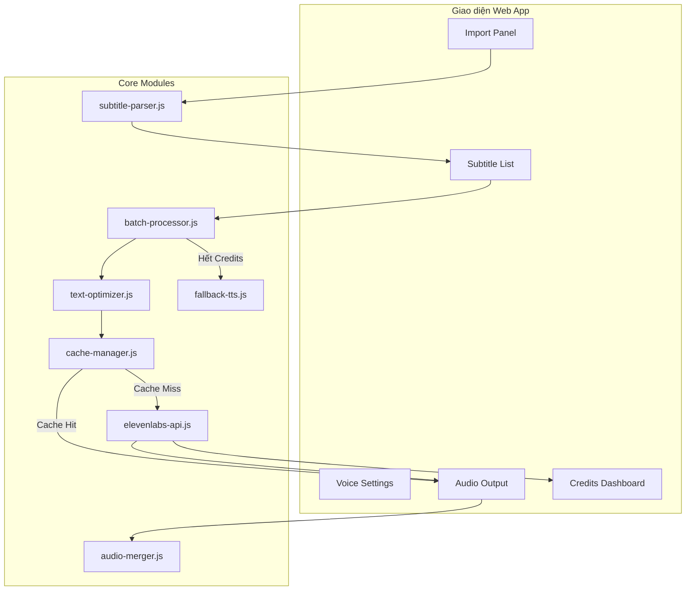
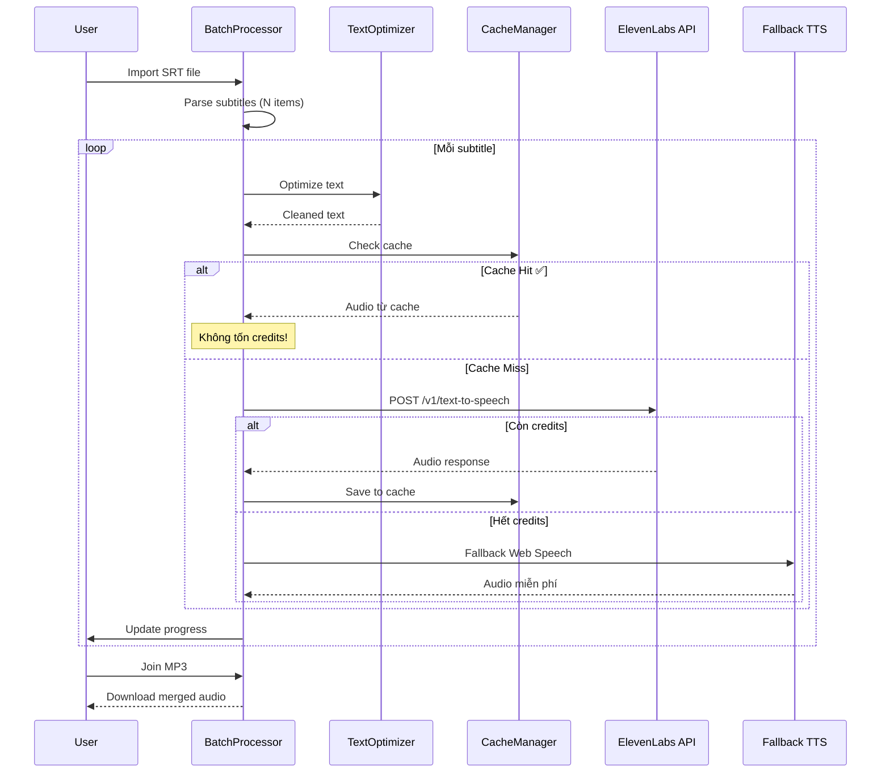

# Tool Giọng Đọc ElevenLabs - Kế Hoạch Triển Khai (Cập nhật)

## Bối cảnh & Mục tiêu

Tạo một **web app Text-to-Speech** tương tự tool **"Dan Media Auto TTS Subtitles 4.7"**, sử dụng ElevenLabs API với khả năng:
- Import file phụ đề (SRT/TXT/ASS/VTT)
- Xử lý batch hàng loạt
- Cài đặt giọng đọc chi tiết
- Xuất/ghép audio MP3
- Tối ưu token credits

---

## Thực tế về giới hạn ElevenLabs

> [!IMPORTANT]
> **Không thể bypass giới hạn token** của ElevenLabs (server-side). Nhưng tool sẽ **tối ưu tối đa** để tiết kiệm 40-70% credits thông qua cache, model Flash, và text optimization.

---

## Tính năng chính (Tham khảo từ Dan Media Auto TTS)

### 🎙️ Panel Voice Settings
| Tính năng | Mô tả |
|:---|:---|
| **Voice Selection** | Chọn voice từ danh sách ElevenLabs (API `GET /v1/voices`) |
| **Model** | `eleven_multilingual_v2`, `eleven_flash_v2_5`, `eleven_v3` |
| **Speed** | Tốc độ đọc (Slower ↔ Faster) |
| **Stability** | Độ ổn định giọng (More variable ↔ More stable) |
| **Similarity** | Độ giống giọng gốc (Low ↔ High) |
| **Style Exaggeration** | Mức độ biểu cảm (None ↔ Exaggerated) |
| **Speaker Boost** | Tăng cường giọng đọc (toggle) |
| **Language Override** | Ghi đè ngôn ngữ |
| **Output Format** | MP3 44.1kHz (128kbps / 192kbps) |

### 📁 Panel Import & Batch
| Tính năng | Mô tả |
|:---|:---|
| **Import File** | Import `.srt`, `.txt`, `.ass`, `.vtt` |
| **Import Folder** | Import cả thư mục file |
| **Batch Processing** | Xử lý hàng loạt tất cả subtitles |
| **Auto Start** | Tự động bắt đầu sau import |
| **Progress Tracking** | Done / Processing / Total / Elapsed time |
| **Pause/Resume** | Tạm dừng / tiếp tục batch |

### 🎵 Panel Audio Output
| Tính năng | Mô tả |
|:---|:---|
| **Preview Audio** | Nghe thử từng dòng subtitle |
| **Download từng file** | Tải MP3 riêng lẻ |
| **Join MP3** | Ghép tất cả audio thành 1 file MP3 |
| **Open Audio Output** | Mở/tải thư mục output |

### 💰 Panel Credits Tracking
| Tính năng | Mô tả |
|:---|:---|
| **Credits remaining** | Số credits còn lại |
| **Expiration date** | Ngày hết hạn credits |
| **Characters used** | Số ký tự đã dùng trong session |
| **Cache savings** | Số ký tự tiết kiệm được nhờ cache |

---

## Chiến lược tối ưu Token

### 1. 🗄️ Cache thông minh (IndexedDB) — Tiết kiệm ~40-70%
- Key = `hash(text + voice_id + model + settings)`
- Text đã tạo → phát lại từ cache, **không gọi API**

### 2. ⚡ Model Flash mặc định — Gấp đôi output
- `eleven_flash_v2_5` cho **gấp đôi** ký tự với cùng credit
- User có thể chuyển sang Multilingual v2 khi cần chất lượng cao hơn

### 3. ✂️ Tối ưu văn bản — Tiết kiệm ~10-20%
- Loại bỏ whitespace thừa, normalize ký tự
- Hiển thị so sánh trước/sau tối ưu

### 4. 🔄 Fallback Web Speech API — Miễn phí 100%
- Khi hết credits → tự động dùng `speechSynthesis` browser
- User có thể chọn sử dụng chế độ này bất cứ lúc nào

---

## Kiến trúc ứng dụng

---

## Proposed Changes

### Component 1: Entry Point & Layout

#### [NEW] [index.html](file:///f:/tool%20giọng%20đọc/index.html)
- Layout 3 panel: Import/Subtitles (trái), Audio Preview (giữa-dưới), Voice Settings (phải)
- Header: logo, tên app, nút cài đặt API key
- Footer: credits tracker bar
- Responsive design

#### [NEW] [styles.css](file:///f:/tool%20giọng%20đọc/styles.css)
- Dark theme premium (#0f0f23 background)
- Glassmorphism panels
- Gradient accents (purple → cyan)
- Micro-animations, hover effects
- Custom scrollbar, sliders
- Responsive breakpoints

---

### Component 2: Core JavaScript Modules

#### [NEW] [js/app.js](file:///f:/tool%20giọng%20đọc/js/app.js)
- Main controller: khởi tạo tất cả modules
- Event delegation, UI state management
- API key dialog management
- Theme & settings persistence

#### [NEW] [js/elevenlabs-api.js](file:///f:/tool%20giọng%20đọc/js/elevenlabs-api.js)
- Class `ElevenLabsAPI`
- Methods:
  - `getVoices()` → danh sách voices
  - `textToSpeech(text, voiceId, settings)` → audio blob
  - `getSubscription()` → credits info + expiration
  - `getModels()` → danh sách models
- Rate limiting với exponential backoff
- Error handling (429, 401, 500)

#### [NEW] [js/subtitle-parser.js](file:///f:/tool%20giọng%20đọc/js/subtitle-parser.js)
- Parse `.srt` files (timestamp + text)
- Parse `.ass` / `.ssa` files
- Parse `.vtt` (WebVTT) files
- Parse `.txt` files (line-by-line)
- Trả về array: `[{index, startTime, endTime, text}]`

#### [NEW] [js/cache-manager.js](file:///f:/tool%20giọng%20đọc/js/cache-manager.js)
- IndexedDB wrapper cho audio cache
- `generateKey(text, voiceId, model, settings)` → SHA-256 hash
- `get(key)`, `set(key, audioBlob)`, `delete(key)`
- `getStats()` → tổng cache, dung lượng, hit rate
- `clearAll()`, `export()`, `import()`

#### [NEW] [js/text-optimizer.js](file:///f:/tool%20giọng%20đọc/js/text-optimizer.js)
- `optimize(text)` → cleaned text
- `chunkText(text, maxChars)` → array of chunks
- `countChars(text)` → character count
- Strip HTML tags, normalize whitespace

#### [NEW] [js/batch-processor.js](file:///f:/tool%20giọng%20đọc/js/batch-processor.js)
- Class `BatchProcessor`
- Queue management: add, remove, reorder subtitles
- Sequential processing với concurrency control
- Status tracking: Pending → Processing → Done → Error
- Pause / Resume / Cancel
- Progress callback: `onProgress(done, total, elapsed)`
- Auto-retry on failure (max 3 attempts)

#### [NEW] [js/audio-merger.js](file:///f:/tool%20giọng%20đọc/js/audio-merger.js)
- `mergeAudioBlobs(blobs[])` → single audio blob
- Sử dụng Web Audio API để nối audio
- Tùy chọn thêm khoảng lặng giữa các đoạn (gap ms)
- Xuất MP3 (sử dụng lamejs library)

#### [NEW] [js/fallback-tts.js](file:///f:/tool%20giọng%20đọc/js/fallback-tts.js)
- Wrapper cho `window.speechSynthesis`
- `getVoices()` → voices browser
- `speak(text, voice, rate, pitch)` → audio
- Hoàn toàn miễn phí, không giới hạn

---

## Sơ đồ xử lý Batch

---

## User Review Required

> [!WARNING]
> **API Key:** Tool chạy client-side, API key lưu trong browser localStorage. Nếu cần bảo mật cao hơn, sẽ cần backend Node.js.

> [!IMPORTANT]  
> **Join MP3:** Để ghép audio thành file MP3 trong browser, cần sử dụng thư viện `lamejs` (JavaScript MP3 encoder). File sẽ được load từ CDN. Bạn có đồng ý không?

---

## Open Questions

> [!IMPORTANT]
> 1. **Bạn có API key ElevenLabs chưa?** (Cần để test tool)
> 2. **Bạn muốn mặc định tiếng Việt hay tiếng Anh?**
> 3. **Output format:** MP3 44.1kHz 128kbps có OK không? Hay cần thêm tùy chọn WAV/OGG?
> 4. **Có cần tính năng "Import Voice"** (import voice settings từ file) không?

---

## Verification Plan

### Manual Verification
1. Nhập API key → verify kết nối → hiển thị danh sách voices
2. Import file SRT → hiển thị danh sách subtitles
3. Chạy batch → kiểm tra progress tracking
4. Chạy lại cùng file → verify cache hit (không gọi API)
5. Join MP3 → tải xuống → kiểm tra audio
6. Test fallback khi không có API key
7. Test responsive trên nhiều kích thước màn hình
